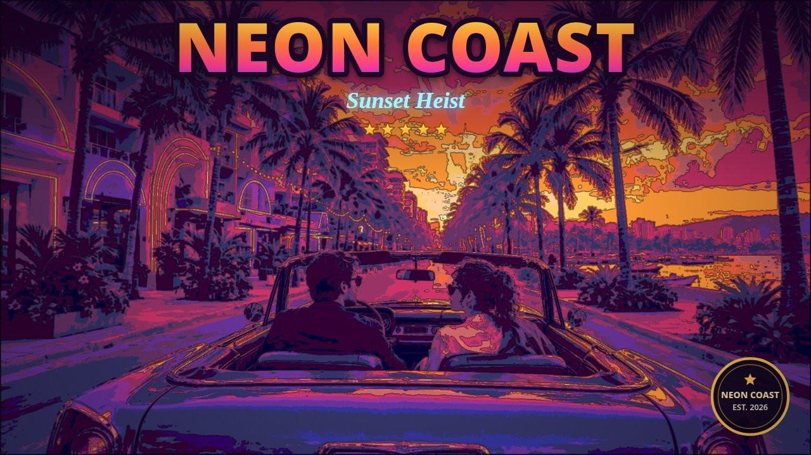
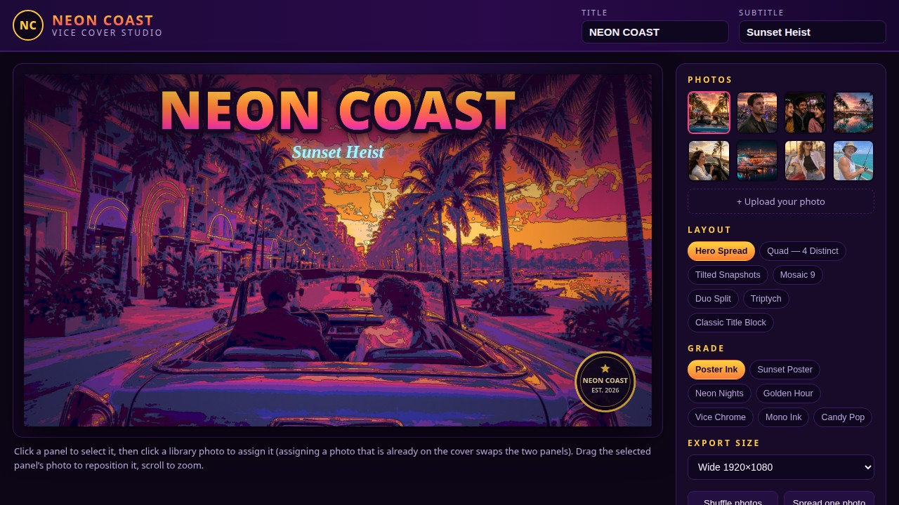
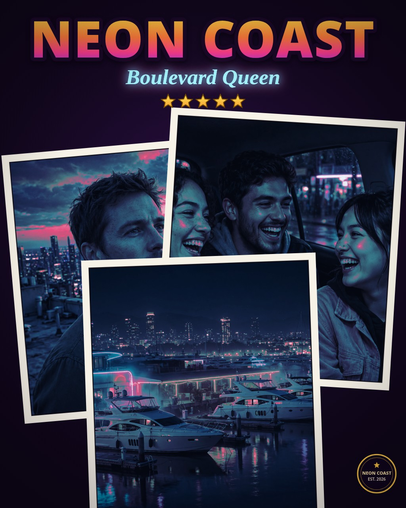
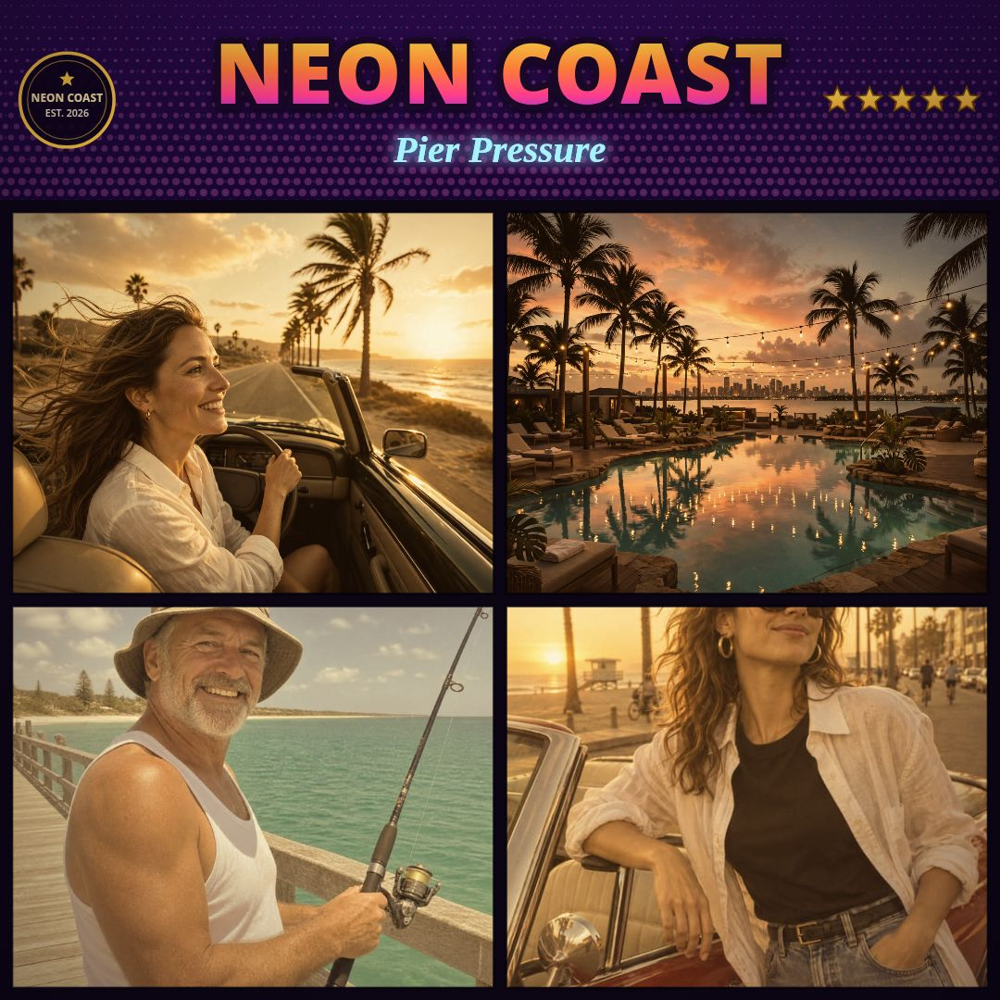

# NEON COAST — Vice Cover Studio

A fully offline web app that turns your own photos and a caption into
GTA-style cover art. The v5 flagship is the **Hero Spread**: one hero photo
spread full-bleed across the whole cover, inked as poster art, with huge
sunset-gradient title lettering, a neon-script subtitle, a five-star heat
meter, film grain and a vignette.

**Hard rule of the studio: no photo ever appears twice on one cover.**
Every panel shows a different photo — assigning a photo that is already on
the cover swaps the two panels instead of duplicating it.

## Layouts (7)

- **Hero Spread** — one photo full-bleed, title across the top, badge in the corner
- **Quad — 4 Distinct** — a 2×2 grid of four different photos under a halftone title block
- **Tilted Snapshots** — three framed photos tilted like prints on a board
- **Mosaic 9** — a 3×3 mosaic of eight different photos around a graphic title-block centre
- **Duo Split** — two photos side by side, title over a bottom scrim
- **Triptych** — three tall panels under a top scrim
- **Classic Title Block** — halftone title block over a row of three panels

## Grades (7 canvas pixel pipelines)

Poster Ink (gradient map → saturation lift → posterize → soft Sobel ink
edges, so faces stay readable), Sunset Poster, Neon Nights, Golden Hour,
Vice Chrome, Mono Ink and Candy Pop. Every render is finished with film
grain and a vignette.

## Photos

Eight photos ship with the app: six generated assets (`app/assets/`) plus
two starter samples (`app/samples/`). You can also upload your own photo —
it never leaves the page.

## Editing

Click a panel to select it, then click a library photo to assign it. Drag
the selected panel's photo to reposition it, scroll to zoom. Edit the
title and subtitle, shuffle the photos, spread one photo across the whole
cover, undo and redo.

## Export

Export PNG at the selected size, or export all sizes at once:
1080×1080, 1080×1350, 1920×1080 and 1080×1920.

## Run it

Open `app/index.html` in any desktop browser — no server, no build, no
network. Or run `node main.ts` (Node 22, standard library only) to copy
`app/` and `screenshots/` into `$MAKEFUN_OUTPUT_DIR` and write the entry's
`dossier.json`.

Deterministic screenshot scenes live in `shots.json` and
`app/src/shots.js`: open `app/index.html?shot=cover` (or `editor`,
`portrait`, `square`) and the app renders that exact scene.

## Screenshots

